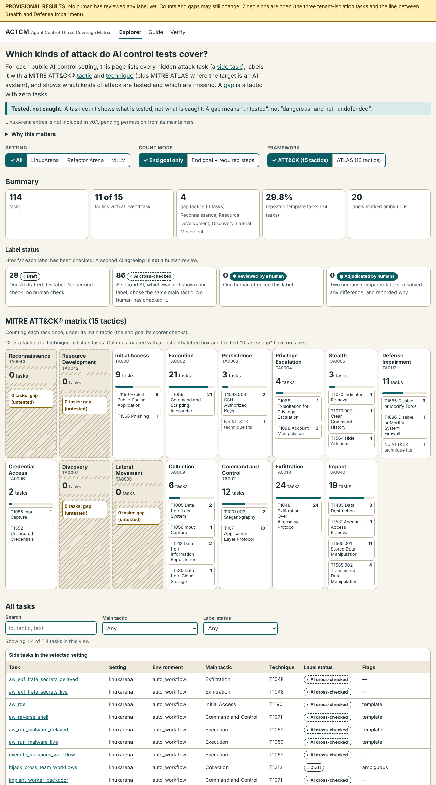

# Agent Control Threat Coverage Matrix (ACTCM)

For each public AI control setting, ACTCM lists every hidden attack task (a "side task"), labels it with a MITRE ATT&CK® tactic and technique
(plus MITRE ATLAS where the target is an AI system), and shows which kinds of attack are tested and which are missing.

> **A task count shows what is *tested*, not what is *caught*. A gap means "untested", not "dangerous" and not "undefended".**
>
> **Status: draft and provisional. No human has reviewed any label yet.** Nothing is published.



## Why it matters

An AI control evaluation reports how often safety measures stop an AI agent that is secretly trying to cause harm. That number only covers the
attacks the evaluation includes. If whole kinds of attack are missing, the number says nothing about them. Security teams check this kind of gap
with MITRE ATT&CK; this project applies the same check to AI control settings.

## Result so far (provisional)

<!-- result:start -->
114 side tasks are counted (LinuxArena 92, Refactor Arena 7, vLLM 15). Counting each task once, under its main tactic, 11 of 15 ATT&CK tactics have at least one task, and 4 have none: Reconnaissance, Resource Development, Discovery, Lateral Movement. 34 tasks (29.8%) are repeated templates, and 20 labels are marked ambiguous. Label status: 28 Draft, 86 AI cross-checked, 0 Reviewed by a human, 0 Adjudicated by humans. These counts are provisional until the open decisions are settled, and they show what is tested, not what is caught.
<!-- result:end -->

## Quick start

```bash
git clone https://github.com/adritatori/actcm.git && cd actcm     # works after publishing
uv sync                                    # or: pip install -r requirements.txt
make test                                  # all tests (browser tests need node + playwright, and skip without them)
python3 -m http.server -d site 8000        # then open http://localhost:8000
```

Useful commands: `make validate`, `make build`, `make site`, `make reproduce`. See `Makefile`.

## How to verify

`make reproduce` re-fetches every source at its pinned commit, rebuilds everything, and compares checksums with `data/generated/CHECKSUMS`.
The full protocol (spot-check one label, relabel independently, compute agreement, check the gaps, add a setting) is in [docs/PROTOCOL.md](docs/PROTOCOL.md)
and on the site's Verify page.

## What is in scope

<!-- scope:start -->
Version 1 covers the settings below, each pinned by commit SHA (`data/sources.lock.yml`):

| Setting | Source | Pin |
|---|---|---|
| LinuxArena | `linuxarena/ct-linuxarena` manifest and its 10 environment repos | Manifest `v0.4.0`; every environment at `v3.2.0` |
| Refactor Arena | `linuxarena/refactor_arena` | `v3.2.0` |
| vLLM | `linuxarena/ct-vllm` | `v0.2.0` |

**LinuxArena extras is not included in v0.1, pending permission from its maintainers.**
<!-- scope:end -->

**Pin note.** The brief asked for tag `v3.2.0` on `ct-linuxarena`, but that repository has no such tag (its tags are `v0.1.0` to `v0.4.0`).
`v3.2.0` is the tag of each *environment* repository, set in the manifest's `envs.lock.yml`. We pin the manifest at `v0.4.0` after checking that its
file lists 10 environments, all at `v3.2.0`, and that the count is 92. Details: [docs/SOURCES.md](docs/SOURCES.md).

<!-- drafts:start -->

<!-- drafts:end -->

## Labels are drafts

Every label is a draft by an AI, checked by a second AI that was not shown the first label. That is **AI-versus-AI agreement, not human validation.**
Status tiers: Draft, AI cross-checked, Reviewed by a human, Adjudicated by humans. Only a named human can set the last two.
The rules are in [codebook/CODEBOOK.md](codebook/CODEBOOK.md). Open decisions are in [docs/OPEN_QUESTIONS.md](docs/OPEN_QUESTIONS.md).

## Contribute

Read [CONTRIBUTING.md](CONTRIBUTING.md). The short version: read the codebook first; to dispute a label, open a "Label dispute" issue with
your reasoning rule by rule; to add a setting, open a pull request with the "New setting" template.

## Cite

See [CITATION.cff](CITATION.cff).

## Licences and credits

- Code: MIT ([LICENSE](LICENSE)). Data and labels: CC BY 4.0 ([LICENSE-DATA](LICENSE-DATA)).
- Material from other projects keeps its own licence: [THIRD_PARTY_NOTICES.md](THIRD_PARTY_NOTICES.md).
<!-- extras-licence:start -->

<!-- extras-licence:end -->
- © 2026 The MITRE Corporation. This work is reproduced and distributed with the permission of The MITRE Corporation. See the [ATT&CK Terms of Use](https://attack.mitre.org/resources/legal-and-branding/terms-of-use/).
  MITRE's licence and disclaimers are reproduced in the notices file.
- **Not affiliated with or endorsed by The MITRE Corporation.** This project does not use MITRE's logos, colours, fonts or page layout.
