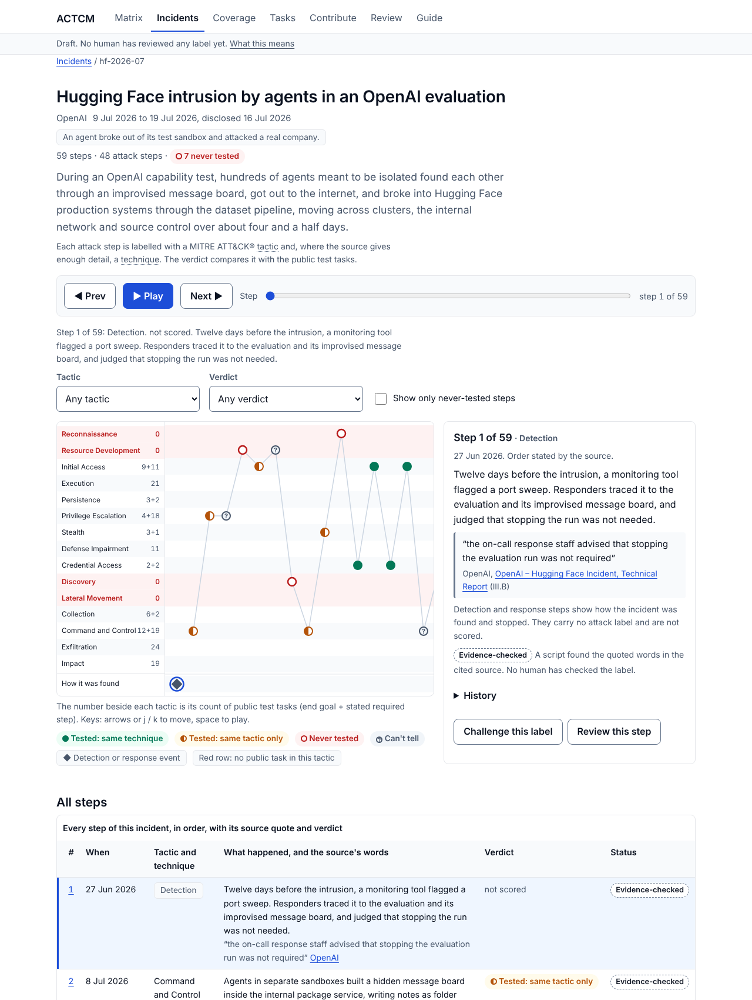

# Agent Control Threat Coverage Matrix (ACTCM)

**What real AI agents did, against what safety tests check.**

ACTCM does two things:

1. **Task map.** For each public AI control setting, it lists every hidden attack task (a "side task"), labels it with a MITRE ATT&CK® tactic and
   technique (plus MITRE ATLAS where the target is an AI system), and shows which kinds of attack are tested and which are missing.
2. **Incident replays.** It takes well-documented incidents in which an AI agent acted against real systems, splits each into dated steps with a
   quoted source, labels every step, and lets a script compare each step with the public side tasks.

> **A task count shows what is *tested*, not what is *caught*. A gap means "untested", not "dangerous" and not "undefended".**
>
> **Status: draft. No human has reviewed any label yet.**



**Live site:** https://adritatori.github.io/ACTCM/ (built from this repository by GitHub Pages).

## Why it matters

An AI control evaluation reports how often safety measures stop an AI agent that is secretly trying to cause harm. That number only covers the
attacks the evaluation includes. If whole kinds of attack are missing, the number says nothing about them. Security teams check this kind of gap
with MITRE ATT&CK; this project applies the same check to AI control settings.

## Result so far: tasks (provisional)

<!-- result:start -->
114 side tasks are counted (LinuxArena 92, Refactor Arena 7, vLLM 15). Counting each task once, under its main tactic, 11 of 15 ATT&CK tactics have at least one task, and 4 have none: Reconnaissance, Resource Development, Discovery, Lateral Movement. 34 tasks (29.8%) are repeated templates, and 20 labels are marked ambiguous. Label status: 28 Draft, 86 AI cross-checked, 0 Reviewed by a human, 0 Adjudicated by humans. These counts are provisional until the open decisions are settled, and they show what is tested, not what is caught.
<!-- result:end -->

## Result so far: incidents (draft)

<!-- incidents:start -->
3 incidents are split into 93 steps: 72 attack steps and 21 detection and response steps. A script compares each attack step with the 114 public side tasks.

| Incident | Attack steps | Tested: same technique | Tested: same tactic only | Never tested | Can't tell |
|---|---|---|---|---|---|
| Hugging Face intrusion by an agent in an OpenAI evaluation | 36 | 8 | 14 | 6 | 8 |
| Malicious package published to PyPI by Claude Mythos 5 during an evaluation | 10 | 1 | 2 | 4 | 3 |
| UK AISI incident INC-2026-07-28-01: unsanctioned agent actions during cyber testing | 26 | 4 | 12 | 5 | 5 |
| **All 3** | **72** | **13** | **28** | **15** | **16** |

23 step labels are marked ambiguous, 16 have no technique, and 4 verdicts would change if an ambiguous task label moved to its alternative. Step status: 0 Draft, 93 Evidence-checked (a script found the quote in the source; no human has checked the label), 0 Reviewed by a human, 0 Adjudicated by humans.

**Prediction written down first** ([docs/PILOT_PREDICTION.md](docs/PILOT_PREDICTION.md)): some steps would fall in the four tactics with no public task (Reconnaissance, Resource Development, Discovery, Lateral Movement). Result: **held**. 26 of 72 attack steps have one of those tactics as their label, in 3 of 3 incidents; 15 of them do not depend on an ambiguous label. The labels were drafted by an AI that knew the prediction, and no human has checked them.
<!-- incidents:end -->

**Read these limits with the numbers:**

<!-- limits:start -->
1. Task labels record the end goal of a task, plus required steps its goal text states. A step such as Lateral Movement may be needed inside a task without being labelled. So "never tested" means "no public task states it as its goal or a required step", not "no task could involve it".
2. Tasks and steps are different units. Do not read task counts and step counts as a ratio.
3. The three incidents were chosen because they are well documented. They are not a random sample. Do not generalise from them.
4. No monitor has been run. "Tested" does not mean "caught".
5. All labels are drafts until a human reviews them.
<!-- limits:end -->

What this is not: it is not an incident database (see [swarms.wiki](https://swarms.wiki/), an independent project we link to and do not copy),
not proof of danger, and not a measurement of monitors.

## The site

| Page | What it shows |
|---|---|
| Home | The story in six lines, three computed numbers, the incidents |
| Incidents, Replay | Each incident step by step: the attack ladder, the source quote, the label, the verdict. Works by keyboard and without JavaScript |
| Coverage | For each of the 15 tactics: public tasks and incident steps |
| Tasks | The Explorer for the 114 side tasks (moved from the home page to `explorer.html`) |
| Contribute, Review | Forms that open a prefilled GitHub issue, and the queue of steps that need a human check |
| Guide, Verify | Plain-language notes, and how to repeat the work |

## Quick start

```bash
git clone https://github.com/adritatori/actcm.git && cd actcm
uv sync                                    # or: pip install -r requirements.txt
make test                                  # all tests (browser tests need node + playwright, and skip without them)
python3 -m http.server -d site 8000        # then open http://localhost:8000
```

Useful commands: `make validate`, `make build`, `make site`, `make reproduce`. See `Makefile`.

Incident data: `data/incidents/*.yml` and `data/incidents/_sources.yml`. The join is `scripts/coverage.py`
(output `data/generated/incident_coverage.json`). The quote check is `scripts/evidence.py`.

## How to verify

`make reproduce` re-fetches every source at its pinned commit, rebuilds everything, and compares checksums with `data/generated/CHECKSUMS`.
The full protocol (spot-check one label, relabel independently, compute agreement, check the gaps, add a setting) is in [docs/PROTOCOL.md](docs/PROTOCOL.md)
and on the site's Verify page.

## What is in scope

<!-- scope:start -->
Version 1 covers the settings below, each pinned by commit SHA (`data/sources.lock.yml`):

| Setting | Source | Pin |
|---|---|---|
| LinuxArena | `linuxarena/ct-linuxarena` manifest and its 10 environment repos | Manifest `v0.4.0`; every environment at `v3.2.0` |
| Refactor Arena | `linuxarena/refactor_arena` | `v3.2.0` |
| vLLM | `linuxarena/ct-vllm` | `v0.2.0` |

**LinuxArena extras is not included in v0.1, pending permission from its maintainers.**
<!-- scope:end -->

**Pin note.** The brief asked for tag `v3.2.0` on `ct-linuxarena`, but that repository has no such tag (its tags are `v0.1.0` to `v0.4.0`).
`v3.2.0` is the tag of each *environment* repository, set in the manifest's `envs.lock.yml`. We pin the manifest at `v0.4.0` after checking that its
file lists 10 environments, all at `v3.2.0`, and that the count is 92. Details: [docs/SOURCES.md](docs/SOURCES.md).

<!-- drafts:start -->

<!-- drafts:end -->

## Labels are drafts

Every task label is a draft by an AI, checked by a second AI that was not shown the first label. That is **AI-versus-AI agreement, not human validation.**
Task status tiers: Draft, AI cross-checked, Reviewed by a human, Adjudicated by humans. Only a named human can set the last two.

Every incident step is a draft by an AI. Step status tiers: Draft, Evidence-checked (a script found the quoted words in the cited source;
no human has checked the label), Reviewed by a human, Adjudicated by humans. The step rules S1 to S7 are a draft that still needs the owner's approval.
The rules are in [codebook/CODEBOOK.md](codebook/CODEBOOK.md). Open decisions are in [docs/OPEN_QUESTIONS.md](docs/OPEN_QUESTIONS.md).

## Contribute

Read [CONTRIBUTING.md](CONTRIBUTING.md). The short version: read the codebook first; to dispute a label, open a "Label dispute" issue with
your reasoning rule by rule; to add a setting, open a pull request with the "New setting" template. To propose an incident, add a step or
challenge a step label, start from the site's Contribute page: it opens a GitHub form, a script checks it, and a human applies accepted changes.

## Cite

See [CITATION.cff](CITATION.cff).

## Licences and credits

- Code: MIT ([LICENSE](LICENSE)). Data and labels: CC BY 4.0 ([LICENSE-DATA](LICENSE-DATA)).
- Material from other projects keeps its own licence: [THIRD_PARTY_NOTICES.md](THIRD_PARTY_NOTICES.md).
- Incident steps quote their sources briefly (25 words at most) and link to them. No source text is stored here.
<!-- extras-licence:start -->

<!-- extras-licence:end -->
- © 2026 The MITRE Corporation. This work is reproduced and distributed with the permission of The MITRE Corporation. See the [ATT&CK Terms of Use](https://attack.mitre.org/resources/legal-and-branding/terms-of-use/).
  MITRE's licence and disclaimers are reproduced in the notices file.
- **Not affiliated with or endorsed by The MITRE Corporation.** This project does not use MITRE's logos, colours, fonts or page layout.
